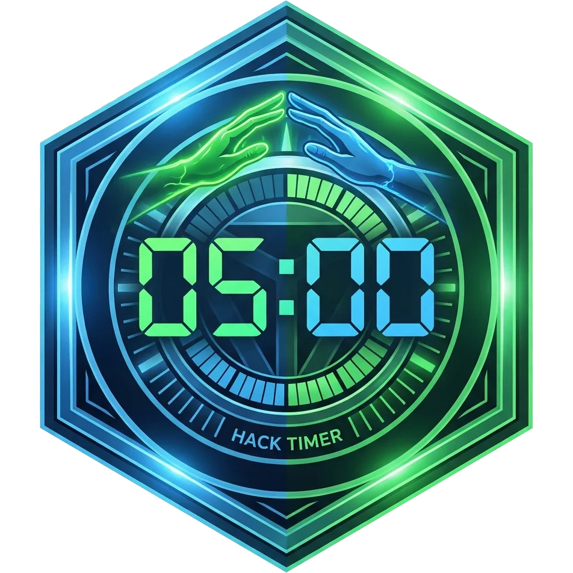
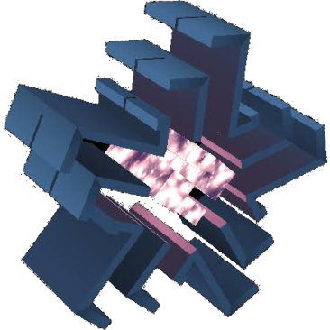

<p align="center">
  
</p>

<h1 align="center">Hack Timer Overlay for Ingress</h1>

<p align="center">
  Floating timer and counter buttons that sit on top of Ingress Prime while you play.<br>
  by GoofyGecko, Enlightened Germany
</p>

---

Hack Timer Overlay for Ingress is a small Android app that draws hexagonal buttons over the game. Each button tracks one of the waits an agent has to keep in mind while farming: portal burnout, hacking speed, how many hacks a portal has left, and the drone cooldown. The buttons only show while Ingress is on screen. When a timer runs out, the phone vibrates and shows a notification.

## Contents

- [Features](#features)
- [The buttons](#the-buttons)
- [Button states and gestures](#button-states-and-gestures)
- [Portal mod calculations](#portal-mod-calculations)
- [Settings](#settings)
- [Permissions](#permissions)
- [Installing](#installing)
- [Building from source](#building-from-source)
- [Project layout](#project-layout)
- [Legal](#legal)

## Features

- **Four kinds of timer and counter**, which you can add several times. Only the drone timer is limited to one.
- **Portal mod setup:** pick the multi-hacks or heat sinks on a portal and the app works out the number of hacks or the cooldown for you.
- **Overlay only while you play:** the buttons appear when Ingress is in front and hide everywhere else.
- **Alerts when a timer ends:** vibration and a notification, even if the phone is asleep (uses exact alarms).
- **Notifications that count down:** a running timer shows a live countdown in the notification shade. Tapping it opens Ingress.
- **Quick Settings tile:** "Hack buttons" hides or shows the overlay without opening the app.
- **Faction:** pick Enlightened or Resistance. The faction logo shows on the settings page, and the heat sink and multi-hack buttons use green or blue symbols to match.
- **Customizable look:** button size, horizontal or vertical row, and button color (Black, Green, Red, Blue).
- **Drag to move:** all buttons sit in one row that you can drag anywhere on the screen.

## The buttons

| | Timer / counter | What it tracks | Default |
|---|---|---|---|
|  | **Portal Burnout Refresh** | A portal burns out after too many hacks and has to rest for 4 hours. | 4:00 h |
|  | **Hacking Speed Timer** | The wait before you can hack the same portal again. Heat sinks make it shorter. | 5:00 min |
|  | **Remaining Hacks Countdown** | How many hacks a portal has left before it burns out. Multi-hacks raise the number. | 4 hacks |
|  | **Drone Timer Cooldown** | The wait before your drone can make a long jump again. | 60 min |

A new installation starts with one of each. Add or remove timers in the timer list on the settings page. Timers are numbered from 1, and when you have more than one of the same kind, the button label includes its number.

## Button states and gestures

| Look | Meaning |
|---|---|
| Yellow text, yellow border | Ready. The button shows the full time or count and has not started yet. |
| White text, white border | Running. A timer is counting down, or the hack counter is below its starting number. |
| Yellow **READY** | The timer has run out. |

**Timers** (Portal Burnout Refresh, Hacking Speed Timer, Drone Timer Cooldown):
- **Tap** starts the timer.
- **Long-press** resets it to the full time without starting it. Tap again to start.

**Remaining Hacks Countdown:**
- **Tap** counts one hack down.
- **Long-press** resets it to the full number of hacks.

## Portal mod calculations

Tap **Setup** next to a Hacking Speed Timer or Remaining Hacks Countdown to open the mod page. It shows the portal's four mod slots in a 2×2 grid. Tap a slot to pick a mod, and the result updates as you go. You can also type a value by hand.

### Remaining Hacks Countdown (multi-hacks)

| Mod | Bonus hacks |
|---|---|
| Common multi-hack (CMH) | +4 |
| Rare multi-hack (RMH) | +8 |
| Very rare multi-hack (VRMH) | +12 |

A portal starts with **4 hacks**. The rarest multi-hack adds its full bonus, and every other multi-hack adds **half** its bonus.

> Example: VRMH + RMH + CMH = 4 + 12 + 8/2 + 4/2 = **22 hacks**

### Hacking Speed Timer (heat sinks)

First choose the portal type:

- **Portal of your own faction:** 180 seconds
- **Neutral or enemy portal:** 300 seconds

| Mod | Cooldown decrease |
|---|---|
| Common heat sink (CHS) | 20 % |
| Rare heat sink (RHS) | 50 % |
| Very rare heat sink (VRHS) | 70 % |

The strongest heat sink counts in full and every other one counts half:

```
cooldown = base × (1 − h) × (1 − a/2) × (1 − b/2) × (1 − c/2)
```

`h` is the strongest heat sink and `a`, `b`, `c` are the others. The result is rounded to the nearest whole second, so .5 and above rounds up.

> Example: enemy portal with VRHS + RHS = 300 × 0.30 × 0.75 = **67.5 → 68 seconds**

## Settings

The settings page is the app's main screen. From top to bottom:

1. **Faction:** Enlightened (green) or Resistance (blue), with the faction logo at the top.
2. **Help text:** what each button does and what the colors mean.
3. **Timer list:** numbered timers with their icons, a **Setup** button for each, ✕ to remove one, and **+ Add timer**.
4. **Look:** button size, horizontal or vertical arrangement, and button color (black by default).
5. **Start overlay / Stop overlay.**
6. **Exact alarms:** a shortcut to allow on-time alerts.
7. **About the app:** version, author and legal notice.

## Permissions

| Permission | Why it's needed |
|---|---|
| Display over other apps (`SYSTEM_ALERT_WINDOW`) | Draws the buttons on top of Ingress. |
| Usage access (`PACKAGE_USAGE_STATS`) | Detects whether Ingress is in front, so the buttons only show while you play. |
| Notifications (`POST_NOTIFICATIONS`) | Countdown and "timer ended" notifications. |
| Alarms & reminders (`SCHEDULE_EXACT_ALARM`) | Alerts on time while the phone sleeps. You grant this yourself in settings. |
| Foreground service (`FOREGROUND_SERVICE`, `FOREGROUND_SERVICE_SPECIAL_USE`) | Keeps the overlay running. |
| Vibration (`VIBRATE`) | Vibrates when a timer ends. |
| Run at startup (`RECEIVE_BOOT_COMPLETED`) | Sets the alarms again after a restart. |

The app has no internet permission. All data stays on the phone.

### "Restricted setting" on Android 13 and newer

If you install the APK file directly (from a browser, messenger or file manager), Android blocks **Display over other apps** and **Usage access** at first. The app explains the steps when you tap **Start overlay**. In short:

1. Open **App info** for Hack Timer Overlay for Ingress.
2. Tap the **⋮** menu at the top right and choose **Allow restricted settings**, then confirm with your PIN or fingerprint.
3. Go back and tap **Start overlay** again.

On some phones, the ⋮ option only shows up after you have tried to turn on the setting once. Apps installed from an app store or with `adb install` don't hit this block at all.

## Installing

Requires **Android 8.0 (API 26)** or newer.

1. Build the APK yourself (see below), or get a signed APK from the [Releases](../../releases) page once one is published there.
2. Open it on your phone and allow installing from that source.
3. Open the app, pick your faction, set up your timers and tap **Start overlay**.
4. Grant the permissions it asks for (see [Permissions](#permissions)).

Install from a computer instead, which also avoids the restricted-setting block:

```bash
adb install HackOverlay-release.apk
```

## Building from source

The app is written in plain Java with no AndroidX or other libraries.

| Tool | Version |
|---|---|
| JDK | 17 or newer |
| Android Gradle Plugin | 9.1.0 |
| Gradle (wrapper included) | 9.3.1 |
| compileSdk / targetSdk | 36 |
| minSdk | 26 |

1. Install the Android SDK and create `local.properties` that points to it:
   ```properties
   sdk.dir=/path/to/Android/Sdk
   ```
2. Build a debug APK:
   ```bash
   ./gradlew assembleDebug
   ```
   The APK ends up in `app/build/outputs/apk/debug/`.

### Signed release build

Release signing reads from `keystore.properties` in the project root. This file and the keystore are **not** in the repository. To sign with your own key:

```bash
keytool -genkeypair -v -keystore keystore/release.jks -alias hackoverlay -keyalg RSA -keysize 4096 -validity 10000
```

Then create `keystore.properties`:

```properties
storeFile=keystore/release.jks
storePassword=your-store-password
keyAlias=hackoverlay
keyPassword=your-key-password
```

And build:

```bash
./gradlew assembleRelease
```

Without `keystore.properties` the release build has no signing key, so use the debug build instead. An APK signed with a different key can't be installed over the official one. Uninstall that first.

## Project layout

```
app/src/main/
├── AndroidManifest.xml
├── java/de/goofygecko/hackoverlay/
│   ├── MainActivity.java      Settings page: faction, help, timer list, look, start/stop
│   ├── ModsActivity.java      Portal mod page for multi-hacks and heat sinks
│   ├── AboutActivity.java     About page
│   ├── OverlayService.java    Draws the buttons, runs timers, notifications, Ingress detection
│   ├── Timers.java            Timer list model: add, remove, names, icons, saved values
│   ├── Prefs.java             Settings, mod tables and the hack/cooldown formulas
│   ├── TimerReceiver.java     Exact alarms, startup and alarm-permission changes
│   ├── HideTileService.java   Quick Settings tile to hide/show the buttons
│   └── HexDrawable.java       Hexagon button background with border
└── res/                       Icons, mod pictures, faction logos, launcher icon
symbols/                       Source artwork (PNG and GIMP .xcf)
```

## Legal

Copyright Viktoria Schubert. All rights reserved. See also the [privacy policy](PRIVACY.md).

"Ingress" and the Enlightened and the Resistance logos are the property of Google Inc. This application and GoofyGecko are NOT affiliated in any way with Google Inc, Niantic Labs or Ingress Project.
